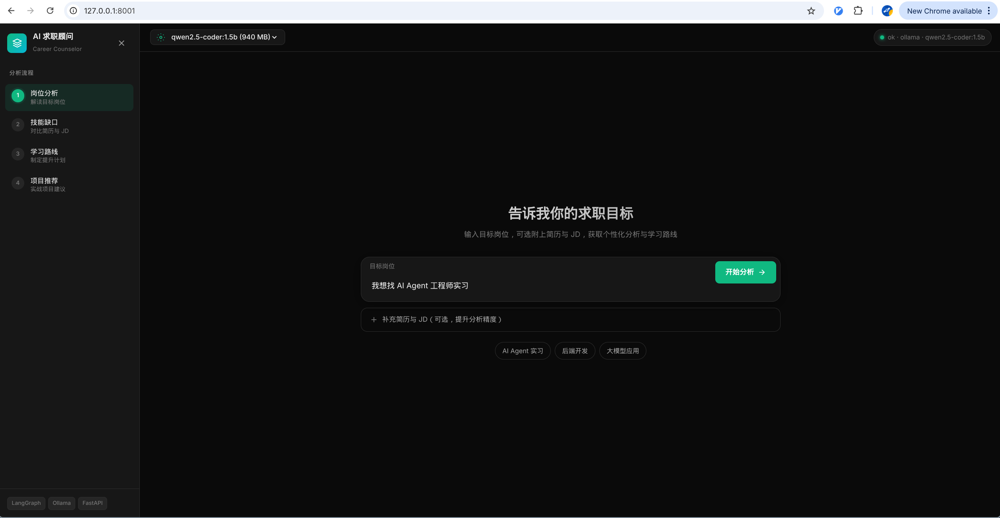

# AI 求职顾问

基于 **FastAPI + LangGraph + Ollama** 的求职 Agent。输入目标岗位（可选附上简历与 JD），自动完成岗位解读、技能缺口分析、学习路线与项目推荐。



## 功能

- **Web 控制台** — 深色主题界面，支持模型切换、健康状态展示与分步结果浏览
- **四步分析流水线** — 岗位分析 → 技能缺口 → 学习路线 → 项目推荐
- **可选上下文** — 补充简历与 JD 可提升分析精度
- **本地 LLM** — 通过 Ollama 运行，支持 Tool Calling 结构化输出
- **降级兜底** — Ollama 不可用时自动切换为规则引擎 fallback

## 技术栈

| 组件 | 用途 |
|------|------|
| **FastAPI** | API 层与静态前端托管 |
| **LangGraph** | 多节点 Agent 编排 |
| **Ollama** | 容器内 LLM 推理 |
| **Pydantic** | 请求/响应与 Tool schema 校验 |

## 快速开始

```bash
cp .env.example .env   # 按需修改 OLLAMA_MODEL、端口等
docker compose up --build -d
docker exec job-counselor-ollama ollama pull qwen2.5:7b
```

浏览器打开 [http://localhost:8001](http://localhost:8001)，在顶部选择已拉取的模型，输入求职目标后点击「开始分析」。

> 截图示例使用 `qwen2.5-coder:1.5b`，可按需 `ollama pull` 其他模型并在界面切换。

## 本地开发

```bash
python -m venv .venv && source .venv/bin/activate
pip install -e ".[dev]"
# 另起终端启动 Ollama，确保 http://localhost:11434 可访问
uvicorn api.server:app --reload --port 8001
pytest
```

## API

### 健康检查

```bash
curl http://localhost:8001/api/health
```

### 可用模型列表

```bash
curl http://localhost:8001/api/models
```

### 发起咨询

```bash
curl -X POST http://localhost:8001/api/consult \
  -H "Content-Type: application/json" \
  -d '{
    "user_query": "我想找 AI Agent 实习",
    "resume_text": "Python, Docker, LangChain",
    "jd_text": "熟悉 Agent 框架与 Tool Calling",
    "model": "qwen2.5:7b"
  }'
```

`model` 为可选字段，省略时使用 `.env` 中的 `OLLAMA_MODEL`。

## 架构

```text
用户输入（Web / API）
  ↓
FastAPI  POST /api/consult
  ↓
LangGraph StateGraph
  ├── JobAnalyzer        (extract_job_profile)
  ├── SkillGapAnalyzer   (analyze_skill_gap)
  ├── LearningPlanner    (build_learning_plan)
  └── ProjectRecommender (recommend_projects)
  ↓
Pydantic 结构化 JSON 响应
```

## 环境变量

见 `.env.example`：

| 变量 | 说明 | 默认值 |
|------|------|--------|
| `WEBUI_PORT` | Web 服务端口 | `8001` |
| `OLLAMA_PORT` | Ollama 端口 | `11434` |
| `OLLAMA_MODEL` | 默认模型（须与 `ollama list` 一致） | `qwen2.5:7b` |
| `WEBUI_API_TOKEN` | API 鉴权 Token（可选，留空则关闭） | — |
| `LOG_LEVEL` | 日志级别 | `INFO` |

## 目录

```text
agent/       LangGraph 节点与流水线
api/         FastAPI + 静态前端（index.html / app.js / styles.css）
config/      配置与 LLM
models/      Pydantic 模型
tests/       单元与集成测试
```
