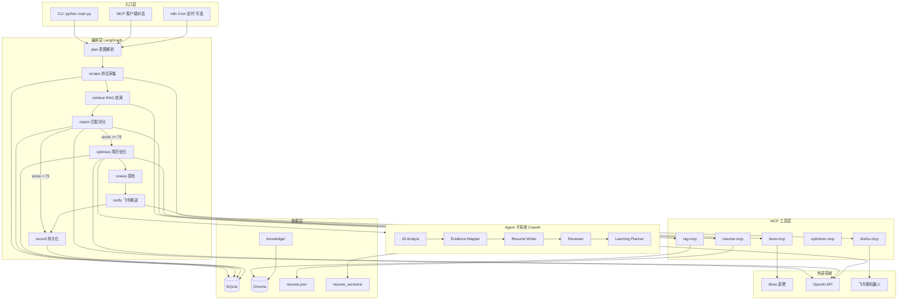
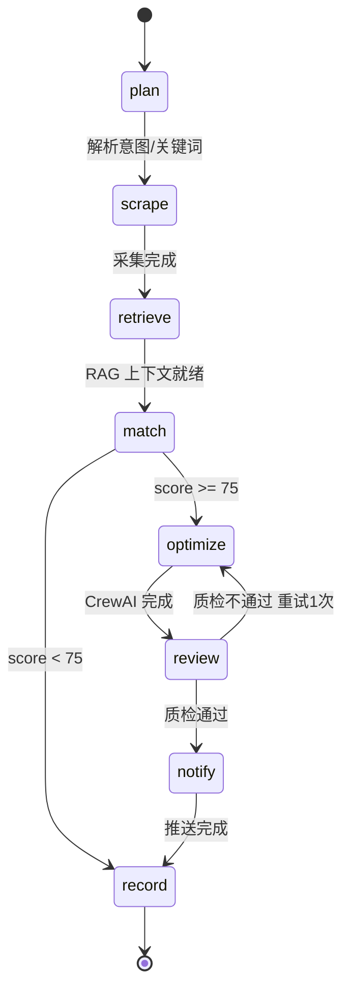

# JobMatch Agent — 项目架构文档

> 基于 Boss 直聘的智能求职 Agent 系统：岗位采集 → RAG 知识增强 → 智能匹配 → 简历优化 → 飞书推送。

---

## 1. 项目概述

JobMatch Agent 是一套面向个人求职场景的自动化 Agent 系统。系统从 Boss 直聘采集岗位，结合个人知识库（RAG）进行匹配评分，对高匹配岗位自动生成定制简历与学习建议，并通过飞书机器人推送通知。

**设计目标**

- 端到端可运行的求职自动化流水线
- Agent 编排（LangGraph）+ 多 Agent 协作（CrewAI）
- RAG 增强匹配与简历优化的可解释性
- MCP 标准协议暴露工具能力，**不绑定任何单一 IDE 或客户端**
- Pydantic 结构化数据流，SQLite 持久化

---

## 2. 总体架构



### 2.1 分层职责

| 层级 | 组件 | 职责 |
|------|------|------|
| 入口 | CLI / MCP 客户端 / n8n | 手动、对话、定时三种触发方式 |
| 编排 | LangGraph StateGraph | 流程控制、条件分支、状态管理、重试 |
| 推理 | CrewAI + OpenAI | 简历优化、学习规划、多角色协作 |
| 工具 | 5 个 MCP Server | 标准化能力暴露，供多种客户端调用 |
| 数据 | Pydantic + SQLite + Chroma | 类型安全、关系型持久化、向量检索 |
| 采集 | Playwright | Boss 直聘浏览器自动化 |
| 通知 | 飞书 Webhook | 岗位卡片、简历建议、学习计划推送 |

---

## 3. MCP 协议与客户端（不局限于 Cursor）

MCP（Model Context Protocol）是 Anthropic 主导的**开放协议**，用于标准化 LLM 应用与外部工具/数据源之间的通信。本项目的 MCP Server 是**独立进程**，通过 stdio 或 HTTP 暴露工具，任何兼容 MCP 的客户端均可连接，**无需修改 Server 代码**。

### 3.1 支持的客户端类型

| 客户端类型 | 示例 | 用途 |
|------------|------|------|
| IDE / 编辑器 | Cursor、VS Code（MCP 插件）、Windsurf | 开发调试、对话式操作 |
| 桌面 AI 应用 | Claude Desktop、ChatGPT Desktop（MCP 支持） | 日常使用、自然语言驱动 |
| Agent 框架 | LangGraph + langchain-mcp-adapters | 自动化流水线、定时任务 |
| 自研应用 | 任意实现 MCP Client 的程序 | 集成到个人工具链 |
| SDK / CLI | `@modelcontextprotocol/sdk`、MCP Inspector | 测试、脚本化调用 |

### 3.2 架构原则：一份 Server，多个 Client

```
                    ┌─────────────────────────────────┐
                    │         MCP Server 层            │
                    │  boss / rag / resume /           │
                    │  optimizer / feishu              │
                    └───────────────┬─────────────────┘
                                    │ MCP 协议 (stdio / HTTP)
          ┌─────────────────────────┼─────────────────────────┐
          │                         │                         │
          ▼                         ▼                         ▼
   ┌─────────────┐          ┌─────────────┐          ┌─────────────┐
   │ Claude      │          │ Cursor      │          │ LangGraph   │
   │ Desktop     │          │             │          │ Agent       │
   └─────────────┘          └─────────────┘          └─────────────┘
          │                         │                         │
          ▼                         ▼                         ▼
   ┌─────────────┐          ┌─────────────┐          ┌─────────────┐
   │ VS Code     │          │ MCP         │          │ n8n +       │
   │ MCP 插件    │          │ Inspector   │          │ FastAPI     │
   └─────────────┘          └─────────────┘          └─────────────┘
```

**关键说明**

- MCP Server 是本项目的能力单元，与客户端解耦
- LangGraph Agent 通过 `langchain-mcp-adapters` 连接同一套 Server，实现自动化
- 人工对话场景可选用 Claude Desktop、Cursor 等任意 MCP 客户端
- 调试时使用 `npx @modelcontextprotocol/inspector` 独立验证 Server

### 3.3 MCP Server 清单

| Server | Tools | 说明 |
|--------|-------|------|
| `boss-mcp` | `search_jobs`, `get_job_detail`, `get_cached_jobs` | Playwright 岗位采集 |
| `rag-mcp` | `retrieve`, `ingest_document`, `list_sources` | 向量检索与文档入库 |
| `resume-mcp` | `get_resume`, `update_skills`, `get_preferences` | 简历主档案读写 |
| `optimizer-mcp` | `optimize_for_job`, `list_versions`, `get_version` | 针对性简历优化 |
| `feishu-mcp` | `send_job_alert`, `send_resume_advice`, `send_summary` | 飞书消息推送 |

### 3.4 客户端配置示例

配置方式因客户端而异，但 Server 启动命令相同。以下为常见客户端的配置参考（路径请替换为实际绝对路径）。

**Claude Desktop**（`~/Library/Application Support/Claude/claude_desktop_config.json` 或 Linux 等价路径）

```json
{
  "mcpServers": {
    "jobmatch-boss": {
      "command": "python",
      "args": ["/path/to/ai_agent/mcp_servers/boss_server.py"],
      "env": {
        "BOSS_STATE_PATH": "/path/to/ai_agent/data/boss_state.json"
      }
    },
    "jobmatch-rag": {
      "command": "python",
      "args": ["/path/to/ai_agent/mcp_servers/rag_server.py"]
    },
    "jobmatch-resume": {
      "command": "python",
      "args": ["/path/to/ai_agent/mcp_servers/resume_server.py"]
    },
    "jobmatch-optimizer": {
      "command": "python",
      "args": ["/path/to/ai_agent/mcp_servers/optimizer_server.py"]
    },
    "jobmatch-feishu": {
      "command": "python",
      "args": ["/path/to/ai_agent/mcp_servers/feishu_server.py"],
      "env": {
        "FEISHU_WEBHOOK": "https://open.feishu.cn/open-apis/bot/v2/hook/xxx"
      }
    }
  }
}
```

**Cursor**（`~/.cursor/mcp.json`）— 配置格式与 Claude Desktop 相同，复用上述 `mcpServers` 块即可。

**LangGraph Agent**（Python 代码内配置）

```python
from langchain_mcp_adapters.client import MultiServerMCPClient

client = MultiServerMCPClient({
    "boss": {
        "transport": "stdio",
        "command": "python",
        "args": ["/path/to/ai_agent/mcp_servers/boss_server.py"],
    },
    "rag": {
        "transport": "stdio",
        "command": "python",
        "args": ["/path/to/ai_agent/mcp_servers/rag_server.py"],
    },
    # ... 其余 Server 同理
})
tools = await client.get_tools()
```

**MCP Inspector**（独立调试）

```bash
npx @modelcontextprotocol/inspector python mcp_servers/resume_server.py
```

---

## 4. 完整数据流

```
① 触发
   用户指令 / 定时任务 / MCP 客户端对话
        ↓
② plan（LangGraph）
   解析意图 → keywords, threshold, actions
        ↓
③ scrape（boss-mcp + Playwright）
   Boss 搜索 → 列表解析 → 详情页 → list[Job]
        ↓
④ retrieve（rag-mcp）
   以 Job.description 为 query → Chroma Top-K
   检索：项目文档 / 笔记 / 面经 / 历史 JD
        ↓
⑤ match（Pydantic Structured Output）
   Job + Resume + RAG 证据 → MatchResult
        ↓
⑥ 分支
   score >= 75 → optimize
   score <  75 → record（仅存档）
        ↓
⑦ optimize（CrewAI ResumeOptimizer Crew）
   JD Analyst → Evidence Mapper → Resume Writer → Reviewer → Learning Planner
   输出 OptimizedResume + LearningPlan
        ↓
⑧ review（规则 + Reviewer Agent）
   拦截捏造、标记「待核实」、ATS 关键词覆盖率检查
        ↓
⑨ notify（feishu-mcp）
   推送：岗位卡片 + 优化简历 + 学习计划
        ↓
⑩ record（SQLite）
   存档 jobs / match_results / resume_versions / notifications
```

---

## 5. LangGraph 状态机



### 5.1 Agent State

```python
class AgentState(TypedDict):
    user_query: str
    keywords: list[str]
    threshold: int
    jobs: list[Job]
    retrieved_context: list[str]
    match_results: list[MatchResult]
    optimized_resumes: list[OptimizedResume]
    learning_plans: list[LearningPlan]
    notified: list[str]
    messages: Annotated[list, add_messages]
```

---

## 6. RAG 知识库

### 6.1 检索方向

RAG 在本项目中的核心用法：**以岗位 JD 为 query，检索用户个人资料**，用于匹配评分与简历优化，而非用项目内容去 Boss 搜索岗位。

```
Query  = 岗位标题 + 岗位描述
Top-K  = 知识库中最相关的项目/笔记/面经片段
用途   = 匹配评分证据 + 简历 bullet 素材
```

### 6.2 知识库目录

| 目录 | 内容 | 用途 |
|------|------|------|
| `data/knowledge/projects/` | 项目 README、实验报告 | 匹配证据、简历 bullet 素材 |
| `data/knowledge/notes/` | Linux、STM32、FPGA 等学习笔记 | 学习计划引用 |
| `data/knowledge/interviews/` | 面经、公司评价 | 辅助投递决策 |
| `data/knowledge/past_jobs/` | 历史 JD、投递结果 | 去重、经验参考 |

### 6.3 技术参数

- 向量库：Chroma（本地持久化）
- Embedding：OpenAI `text-embedding-3-small`
- 切分：512 token，overlap 64
- 检索：Top-K = 5

---

## 7. CrewAI 简历优化流水线

```
输入: Job + MatchResult + RAG 证据 + resume.json
                    │
    ┌───────────────┼───────────────┐
    ▼               ▼               ▼
 JD Analyst    Evidence Mapper   RAG 原文
 解析硬性要求    要求→项目映射
    │               │
    └───────┬───────┘
            ▼
     Resume Writer
     写 summary / bullets / 技能排序
            ▼
       Reviewer
     防捏造 / 标记待核实 / ATS 检查
            ▼
   Learning Planner
     缺失技能 → 本周学习计划
            ▼
输出: OptimizedResume + LearningPlan
```

**约束原则**

- 只能基于 `resume.json` 和 RAG 检索到的内容改写，不得捏造经历
- 无证据的技能只能写「了解/学习中」，并标记「待核实」
- 每个 bullet 必须标注 `evidence_source`
- 默认生成 draft，不自动覆盖主档案（Human-in-the-loop）

---

## 8. 核心数据模型（Pydantic）

### 8.1 Job

```python
class Job(BaseModel):
    id: str                    # hash(company + title)，去重用
    title: str
    company: str
    salary: str
    city: str
    description: str
    url: str
    scraped_at: datetime
```

### 8.2 MatchResult

```python
class MatchResult(BaseModel):
    job_id: str
    score: int                 # 0-100
    advantages: list[str]
    missing: list[str]
    suggest: Literal["推荐投递", "观望", "不推荐"]
    rag_evidence: list[str]    # 引用的知识库片段
    reasoning: str
```

### 8.3 OptimizedResume

```python
class ResumeBullet(BaseModel):
    original: str | None
    optimized: str
    keywords_matched: list[str]
    evidence_source: str
    confidence: Literal["高", "中", "待核实"]

class OptimizedResume(BaseModel):
    job_id: str
    company: str
    title: str
    summary: str
    skills_highlight: list[str]
    project_bullets: list[ResumeBullet]
    experience_bullets: list[ResumeBullet]
    missing_gaps: list[str]
    honest_notes: list[str]
    ats_keyword_coverage: float
    full_markdown: str
    cover_letter_hook: str
```

### 8.4 LearningPlan

```python
class LearningPlan(BaseModel):
    job_id: str
    priority_skills: list[str]
    weekly_plan: list[str]
    resource_links: list[str]
    estimated_hours: int
```

---

## 9. 项目目录结构

```
ai_agent/
├── docs/
│   └── ARCHITECTURE.md          # 本文档
├── README.md
├── pyproject.toml
├── .env.example
├── .gitignore
│
├── config/
│   ├── settings.py              # Pydantic Settings 统一配置
│   └── keywords.yaml            # 搜索关键词、城市、阈值
│
├── models/                      # Pydantic 数据模型
│   ├── job.py
│   ├── resume.py
│   ├── match.py
│   ├── optimizer.py
│   └── agent_state.py
│
├── scraper/                     # Playwright 采集
│   ├── boss_scraper.py
│   ├── parser.py
│   └── session.py
│
├── rag/                         # RAG 知识库
│   ├── ingest.py
│   ├── retriever.py
│   ├── chunker.py
│   └── eval.py
│
├── agent/                       # LangGraph 主编排
│   ├── graph.py
│   ├── nodes/
│   │   ├── plan.py
│   │   ├── scrape.py
│   │   ├── retrieve.py
│   │   ├── match.py
│   │   ├── optimize.py
│   │   ├── review.py
│   │   ├── notify.py
│   │   └── record.py
│   └── prompts/
│
├── crews/                       # CrewAI 子系统
│   ├── resume_optimizer.py
│   └── learning_planner.py
│
├── mcp_servers/                 # MCP 工具层（客户端无关）
│   ├── boss_server.py
│   ├── rag_server.py
│   ├── resume_server.py
│   ├── optimizer_server.py
│   └── feishu_server.py
│
├── notifier/
│   └── feishu.py
│
├── storage/
│   ├── db.py
│   └── vector_store/            # Chroma 持久化
│
├── data/
│   ├── resume.json              # 主档案（单一事实来源）
│   ├── knowledge/               # RAG 源文档
│   ├── resume_versions/         # 按岗位生成的定制简历
│   └── boss_state.json          # Boss 登录态（gitignore）
│
├── api/                         # 可选：供 n8n 调用
│   └── server.py
│
├── scripts/
│   ├── login_boss.py
│   ├── ingest_knowledge.py
│   └── eval_rag.py
│
├── main.py                      # CLI 入口
└── tests/
```

---

## 10. 入口与触发方式

| 方式 | 命令/操作 | 场景 |
|------|-----------|------|
| CLI 手动 | `python main.py run --keywords "Linux驱动,BSP"` | 开发调试 |
| CLI 对话 | `python main.py chat` | 自然语言交互 |
| MCP 客户端 | 任意 MCP 兼容客户端对话 | 日常操作、面试 demo |
| n8n 定时 | Cron → `POST /api/run` | 每日自动推送 |
| MCP Inspector | `npx @modelcontextprotocol/inspector python mcp_servers/xxx.py` | Server 独立调试 |

---

## 11. 存储设计

### 11.1 SQLite 表关系

```
jobs ──┬── match_results
       ├── resume_versions
       ├── notifications
       └── learning_plans
```

- 去重键：`hash(company + title)`
- 简历版本状态：`draft` → `reviewed` → `applied`

### 11.2 文件存储

| 路径 | 说明 |
|------|------|
| `data/resume.json` | 简历主档案，不被 Agent 自动覆盖 |
| `data/resume_versions/` | 按岗位生成的定制简历 Markdown |
| `data/knowledge/` | RAG 原始文档 |
| `storage/vector_store/` | Chroma 向量索引 |
| `data/boss_state.json` | Playwright 登录态（不提交 git） |

---

## 12. 最终实现效果

### 12.1 飞书推送 — 岗位卡片

```
━━━━━━━━━━━━━━━━━━━━━━━━━━━━━━
🔔 JobMatch Agent | 今日推荐 2 个岗位
━━━━━━━━━━━━━━━━━━━━━━━━━━━━━━

📌 Linux BSP 开发实习生
🏢 芯联科技  |  💰 250-350/天  |  📍 上海
⭐ 匹配度：92  |  💡 推荐投递

✅ 优势
  • bsp_lab 项目：I2C/GPIO 驱动移植经验
  • 技能栈 Linux/C/STM32 高度重合

❌ 缺失
  • Device Tree（了解中）
  • CAN 总线

📎 证据来源
  • projects/bsp_lab.md (相似度 0.89)
  • notes/linux_driver.md (相似度 0.85)

🔗 https://www.zhipin.com/job/xxx
━━━━━━━━━━━━━━━━━━━━━━━━━━━━━━
```

### 12.2 飞书推送 — 定制简历

```
📝 针对「芯联科技 - Linux BSP」的简历优化

【Summary】
嵌入式/Linux 方向在校生，具备 STM32 与 Linux 平台驱动
移植经验，熟悉 I2C/GPIO 子系统。

【项目经历 · 建议改写】
  原：做了 BSP 相关实验
  改：基于 Linux 完成 I2C 温湿度传感器 platform 驱动移植，
      实现 probe/remove 与 sysfs 用户态接口
  证据：projects/bsp_lab.md ✓

【ATS 关键词覆盖率】78% (14/18)

【⚠️ 待核实】「了解 DTS」— 确认能否在面试中讲清楚
【❌ 不建议写入】「精通 CAN 总线」— 无项目证据

📎 完整版 → data/resume_versions/20250618_xinlian_bsp.md
```

### 12.3 飞书推送 — 学习计划

```
📚 本周学习计划（针对缺失技能）

  优先级 1: Device Tree 基础
    Mon 2h → 阅读 notes/device_tree.md
    Wed 2h → 在 QEMU 上解析一个 .dts 示例

  优先级 2: CAN 总线入门
    Fri 1h → SocketCAN 概念

  预计总投入：5 小时
```

### 12.4 CLI 对话

```bash
$ python main.py chat

You> 帮我搜 Linux 驱动实习，80 分以上推飞书并优化简历

Agent>
  ✓ [scrape]   采集 12 个岗位
  ✓ [retrieve] 知识库命中 23 条片段
  ✓ [match]    3 个 ≥ 80 分
  ✓ [optimize] 生成 3 份定制简历
  ✓ [notify]   已推送飞书
```

### 12.5 MCP 客户端对话（通用，不限 Cursor）

在 Claude Desktop 或任意 MCP 客户端中说：

> 用我的 resume，搜 Boss 上「Linux 驱动」实习，结合知识库分析，80 分以上推飞书并生成定制简历。

可见工具调用链：

```
→ resume-mcp.get_resume()
→ boss-mcp.search_jobs(["Linux驱动"])
→ rag-mcp.retrieve("Linux驱动 platform driver BSP")
→ optimizer-mcp.optimize_for_job("abc123")
→ feishu-mcp.send_job_alert(...)
→ feishu-mcp.send_resume_advice(...)
```

### 12.6 RAG 可解释性

```bash
$ python main.py explain --job-id abc123
```

```
岗位: Linux BSP 开发实习 @ 芯联科技
匹配度: 92

评分证据:
[1] projects/bsp_lab.md (0.89) — I2C/GPIO 驱动移植...
[2] notes/linux_driver.md (0.85) — platform 设备注册...

对比:
  无 RAG → 预估 76 分（仅 skill 标签）
  有 RAG → 实际 92 分（有项目细节支撑）
```

---

## 13. 技术栈

| 类别 | 技术 |
|------|------|
| 语言 | Python 3.11+ |
| 采集 | Playwright |
| 数据模型 | Pydantic v2 |
| RAG | Chroma + OpenAI Embedding |
| Agent 编排 | LangGraph |
| 多 Agent | CrewAI |
| 工具协议 | MCP（FastMCP 实现） |
| LLM 桥接 | langchain-mcp-adapters |
| LLM | OpenAI GPT-4o / 4o-mini |
| 通知 | 飞书 Webhook |
| 存储 | SQLite + Chroma 文件持久化 |
| 调度 | cron / n8n（可选） |
| API | FastAPI（可选，供 n8n） |
| 可观测 | LangSmith（可选） |

---

## 13.1 当前 Web Console 架构

Web Console 是本项目面向个人使用的主入口，覆盖「导入简历 → `/search` 搜索 → 可视化过程 → 岗位匹配 → 公司/岗位定制简历」闭环。

```mermaid
flowchart LR
    U[用户] --> UI[api/static WebUI]
    UI --> API[FastAPI api/server.py]
    API --> PROFILE[data/resume.json]
    API --> TASK[后台搜索任务队列]
    TASK --> LG[LangGraph Pipeline]
    LG --> BOSS[Boss Playwright Scraper]
    LG --> RAG[Chroma RAG]
    LG --> MATCH[MatchResult]
    LG --> RESUME[定制简历生成]
    LG --> DB[(SQLite)]
    UI <-->|轮询 /api/tasks/{id}| TASK
    UI -->|按岗位生成| API
    API --> VERSIONS[data/resume_versions/]
```

### Web Console 数据流

1. 用户在「我的简历」粘贴过往简历、项目经历、Markdown 或 JSON。
2. `POST /api/import-resume` 解析并生成 `data/resume.json`，这是后续匹配与简历生成的事实来源。
3. 用户在对话框输入 `/search <城市> <岗位关键词> [分数]`，`/api/chat` 创建后台搜索任务。
4. 前端轮询 `/api/tasks/{task_id}`，可视化展示 queued/planning/scraping/retrieving/matching/optimizing/reviewing/notifying/recording/completed 阶段。
5. 搜索任务调用 LangGraph 节点，完成 Boss 采集、RAG 检索、匹配评分、定制简历、复核、通知和入库。
6. 用户在「匹配结果」里选择不同公司和岗位，调用 `POST /api/jobs/{job_id}/generate-resume` 生成岗位专属简历版本。

### 目录与模块职责

| 路径 | 模块职责 |
|------|----------|
| `api/server.py` | FastAPI 应用；提供 WebUI API、配置管理、简历导入、后台任务、slash command、岗位/简历版本查询 |
| `api/static/index.html` | Web Console 页面结构，包含概览、对话助手、简历档案、岗位搜索、匹配结果、简历版本和设置 |
| `api/static/app.js` | 前端状态管理、API 调用、任务轮询、slash command 提示、搜索过程可视化和详情渲染 |
| `api/static/styles.css` | Web Console 视觉样式、响应式布局、进度阶段轨道和表单/列表组件 |
| `agent/graph.py` | LangGraph StateGraph 定义，串联完整求职流水线并根据匹配阈值分支 |
| `agent/nodes/plan_node.py` | 从自然语言或 `/search` 参数中解析城市、关键词和最低匹配分 |
| `agent/nodes/scrape_node.py` | 调用 Boss 采集器，处理登录态、扫码截图回调和岗位去重 |
| `agent/nodes/retrieve_node.py` | 使用岗位 JD 检索个人知识库，提供 RAG 证据 |
| `agent/nodes/match_node.py` | 根据 JD、简历事实档案、搜索词和 RAG 证据计算匹配分 |
| `agent/nodes/optimize_node.py` | 为高分岗位生成定制简历草稿 |
| `agent/nodes/review_node.py` | 标记待核实内容，复核 ATS 关键词覆盖和简历风险 |
| `agent/nodes/notify_node.py` | 将高匹配岗位和摘要推送到飞书 |
| `agent/nodes/record_node.py` | 将岗位、匹配、简历版本和学习计划写入 SQLite |
| `models/` | 定义跨模块传递的数据结构，保证 Job、MatchResult、OptimizedResume、LearningPlan 和 AgentState 类型一致 |
| `scraper/` | Boss 直聘 Playwright 自动化，包括浏览器 session、登录态保存、搜索和 DOM 解析 |
| `rag/` | 知识库文档切分、向量入库和 Chroma 检索 |
| `crews/` | 简历优化与学习计划生成逻辑，强调只使用可验证事实 |
| `storage/db.py` | SQLAlchemy 表结构和 CRUD helper，负责 SQLite 持久化 |
| `notifier/` | 飞书 Webhook 封装，未配置时自动跳过 |
| `mcp_servers/` | Boss/RAG/Resume/Optimizer/Feishu MCP Server，供 IDE、桌面 AI 或自研客户端复用 |
| `config/` | 统一读取 `.env`、模型提供商、数据路径、RAG 参数和匹配阈值 |
| `scripts/` | 登录 Boss、导入知识库等开发/运维脚本 |
| `data/` | 本地业务数据，包括 `resume.json`、`resume_versions/`、Boss 登录态、知识库源文件和 SQLite 数据库 |
| `tests/` | Mock pipeline、完整 LangGraph 和通知分支的集成测试 |

---

## 14. 实施路线

| 阶段 | 周期 | 交付物 | 可演示 |
|------|------|--------|--------|
| Phase 1 | W1 | Pydantic 模型 + Playwright 采集 + 基础匹配 + 飞书 | 搜岗 → 打分 → 推送 |
| Phase 2 | W2 | RAG ingest + 检索 + rag_evidence + explain | RAG 增强匹配 |
| Phase 3 | W3 | LangGraph 全流程 + 5 个 MCP Server + CLI chat | MCP 多客户端 demo |
| Phase 4 | W4 | CrewAI 简历优化 + 学习计划 + 版本管理 + eval | 完整终版 |

---

## 15. 架构一图流（面试用）

```
         ┌─────────── 入口 ───────────┐
         │ CLI / MCP 客户端 / n8n    │
         └─────────────┬─────────────┘
                       ▼
              ┌────────────────┐
              │  LangGraph     │  ← 编排大脑
              │  StateGraph    │
              └───┬───┬───┬───┘
                  │   │   │
        ┌─────────┘   │   └─────────┐
        ▼             ▼             ▼
   boss-mcp       rag-mcp      resume-mcp
   Playwright     Chroma       resume.json
        │             │             │
        └─────────────┼─────────────┘
                      ▼
              ┌────────────────┐
              │  CrewAI        │  ← 简历优化 + 学习规划
              │  4 Agent Crew  │
              └───────┬────────┘
                      ▼
              optimizer-mcp → resume_versions/
                      │
                      ▼
              feishu-mcp → 手机通知
                      │
                      ▼
                   SQLite 存档
```

---

## 16. 安全与合规

- `.env`、`boss_state.json`、飞书 Webhook 不得提交 git
- Boss 直聘采集仅限个人求职用途，控制频率（建议每日 1-2 次）
- 简历优化默认 Human-in-the-loop，Agent 不自动覆盖主档案
- MCP Server 通过环境变量注入密钥，不写死在代码中

---

## 17. 参考资料

- [Model Context Protocol 官方文档](https://modelcontextprotocol.io/)
- [LangChain MCP 集成文档](https://docs.langchain.com/oss/python/langchain/mcp)
- [langchain-mcp-adapters](https://github.com/langchain-ai/langchain-mcp-adapters)
- [FastMCP](https://github.com/jlowin/fastmcp)
- [飞书自定义机器人](https://open.feishu.cn/document/client-docs/bot-v3/add-custom-bot)

---

## 18. 当前实现 vs 架构目标（2026-06）

| 能力 | 架构目标 | 当前实现 |
|------|----------|----------|
| 匹配 | LLM Structured Output | 规则打分 + LLM 精排（`config/llm.py`，无 Key 时降级） |
| 简历优化 | CrewAI 多 Agent | 单 LLM prompt + `review_node` 规则质检 |
| 对话 | LLM 意图解析 | slash 指令 + 关键词路由 |
| MCP | 5 独立 Server | 代码可用，Docker 流水线未默认集成 |
| 任务状态 | 持久化 | SQLite `search_tasks` 表 |
| 运维 | 健康检查/备份/CI | `/api/health` 深度检查、`backup_data.sh`、GitHub Actions |
| 安全 | — | 可选 `WEBUI_API_TOKEN`、配置脱敏 |

个人生产版以 **Web Console + LangGraph 流水线** 为主入口；MCP/CrewAI 为可选扩展，不影响日用闭环。
